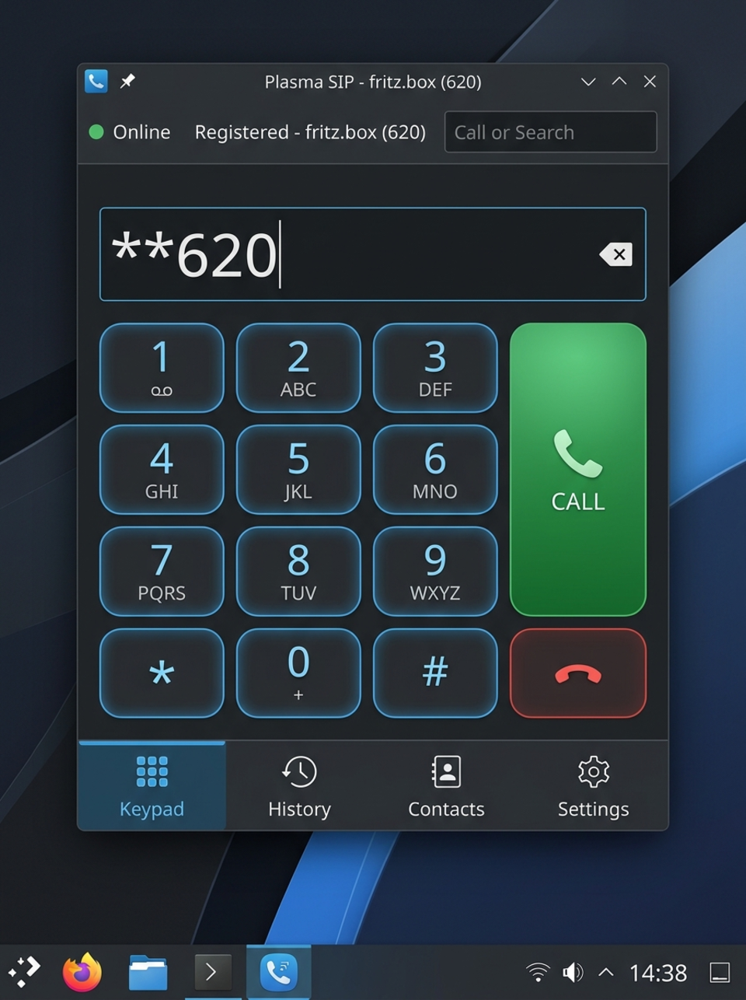

# Plasma SIP — Pure Rust SIP Softphone for KDE Plasma 6

[](https://github.com/DirkTheDaring/plasma-sip-client/releases)
[](https://github.com/DirkTheDaring/plasma-sip-client/actions/workflows/ci.yml)
[](LICENSE)
[](https://kde.org/plasma-desktop/)
[](#)
[](https://pipewire.org/)
[](https://github.com/DirkTheDaring/plasma-sip-client/releases)

<p align="center">
  
</p>

**Plasma SIP** is a modern, pure Rust SIP softphone and VoIP client tailored specifically for KDE Plasma 6 on Linux (Wayland and X11). Built completely from scratch without legacy C/C++ SIP stacks (no PJSIP, Sofia-SIP, or Linphone), it features native low-latency PipeWire audio integration, first-class AVM FRITZ!Box PBX support, KWallet credential security, and background call management via a lightweight D-Bus daemon.

---

## Key Features

- **100% Pure Rust:** Zero legacy C/C++ SIP libraries. Memory safe, highly concurrent, and leak-free.
- **AVM FRITZ!Box Ready:** Native support for local FRITZ!Box PBX registration, internal extension dialing (`**620`), and local IP phone authentication.
- **Phonebook & Contacts Sync:** Built-in TR-064 client synchronizes contact books directly from AVM FRITZ!Boxes and local PBXs into an encrypted SQLite store with T9 quick-search, vanity numbers, and automatic caller name resolution.
- **Convergent 4-Tab Interface:** Streamlined KDE Plasma 6 Kirigami navigation (Keypad, Call History, Contacts, Settings) with ergonomic squircle keypad buttons, real-time extension previews, and seamless theme integration.
- **Provider Agnostic:** Clean provider profile abstraction seamlessly connects with Asterisk, FreePBX, and standard VoIP/SIP services.
- **Native PipeWire Integration:** Low-latency audio processing using pure Rust ITU-T G.711 PCMA/PCMU and lock-free ringbuffers.
- **Background Daemon (`plasma-sipd`):** Uninterrupted call reception and registration maintenance independent of the graphical UI.
- **KWallet / Secret Service Security:** Passwords and credentials are never stored in plaintext on disk.
- **Strict Non-Root Policy:** Security-by-design architecture that strictly enforces user-session execution.

---

## Installation & Packages

### Pre-built Fedora RPMs
Pre-compiled native RPMs, debug packages, and source RPMs are automatically built and verified for the rolling latest-stable Fedora versions (**Fedora 44, 43, 42**):

```bash
# Download the RPM matching your Fedora release from GitHub Releases, then install via DNF:
sudo dnf install ./plasma-sip-*.fc44.x86_64.rpm
```

All package assets, signatures, and build specifications are available on the [GitHub Releases](https://github.com/DirkTheDaring/plasma-sip-client/releases) page.

---

## Documentation Directory

| Document | Purpose |
|---|---|
| [User Guide](docs/USER_GUIDE.md) | Step-by-step setup wizard for FRITZ!Box, call management, dial pad, and D-Bus CLI commands |
| [Architecture Documentation](ARCHITECTURE.md) | Comprehensive 11-crate layered architectural specification |
| [Troubleshooting Guide](docs/TROUBLESHOOTING.md) | Diagnostic solutions for SIP registration, audio devices, and KWallet |
| [Security & Privacy](docs/SECURITY.md) | Threat model, zero-plaintext storage, parser hardening, and sandbox policies |
| [Hardware Test Results](docs/HARDWARE_TEST_RESULTS.md) | AVM FRITZ!Box hardware interoperability matrix and physical test plan |
| [Deployment Report](docs/DEPLOYMENT_REPORT.md) | Final software verification report and quality gate audit |
| [System & User Environment](docs/SYSTEM_ENVIRONMENT.md) | Host OS, DNS resolution, network sockets, D-Bus, PipeWire, and desktop session expectations |
| [Deployment Guide](DEPLOYMENT.md) | Installation scripts, systemd configuration, RPM packaging, and dynamic Fedora release support policy |
| [Testing Strategy](TESTING.md) | Test principles, quality gates, and automated test execution |
| [Changelog](CHANGELOG.md) | Release notes and version history |

---

## Building from Source

### Prerequisites
- Rust 1.85+ (Edition 2024)
- Qt 6 (Declarative, Quick, QuickControls2) & KDE Kirigami 6
- PipeWire development headers (`pipewire-devel`)
- `clang` & `lld`

### Build and Run
```bash
# Clone the repository and build release binaries
cargo build --release --workspace

# Install into your user environment (~/.local/bin)
./packaging/install.sh

# Launch the softphone
plasma-sip
```

### Run Test Suite
```bash
cargo fmt --all -- --check
cargo clippy --workspace --all-targets -- -D warnings
cargo test --workspace --all-targets
```

---

## License

Plasma SIP is licensed under the **GNU General Public License v3.0 or later** (GPL-3.0-or-later). See [LICENSE](LICENSE) for details.

